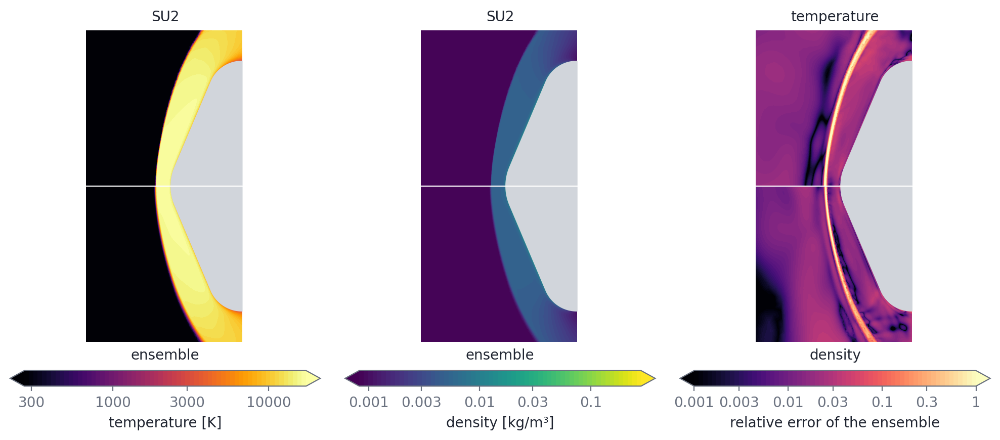
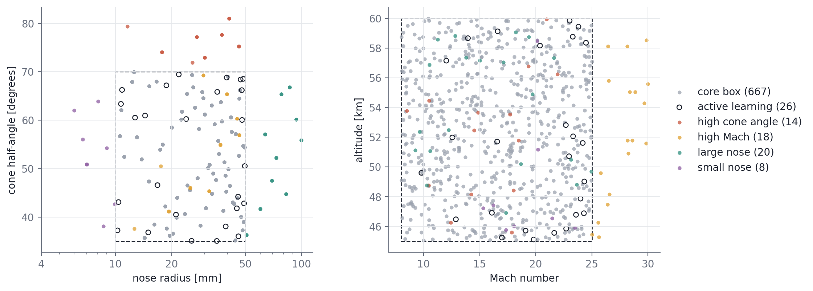
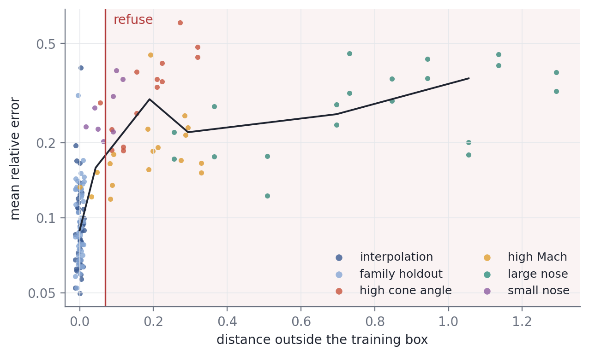
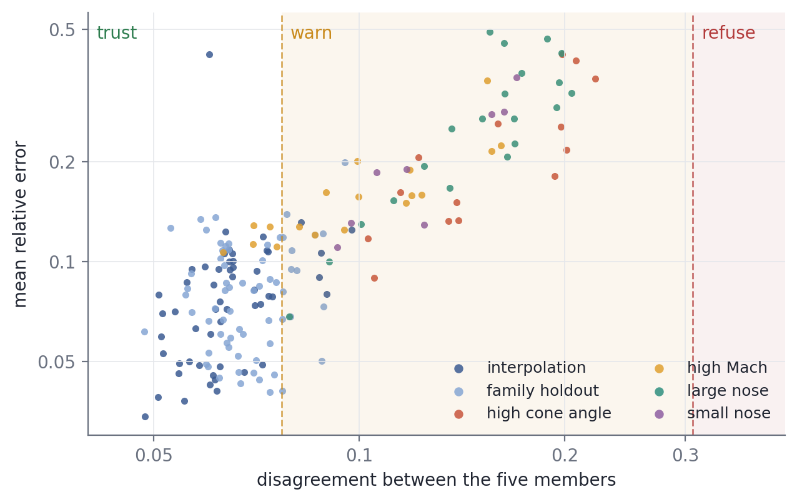
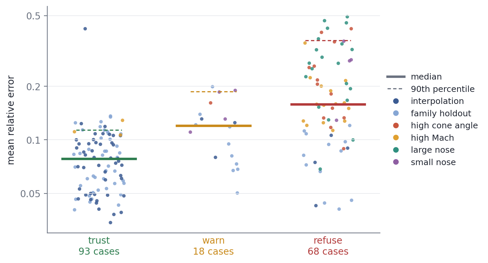
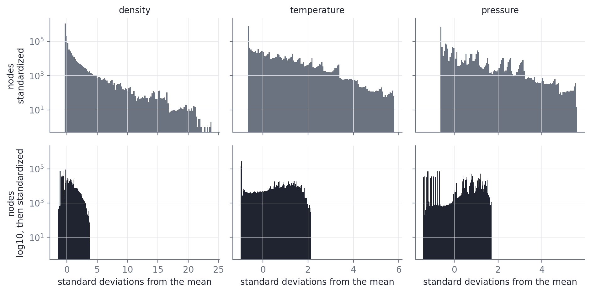
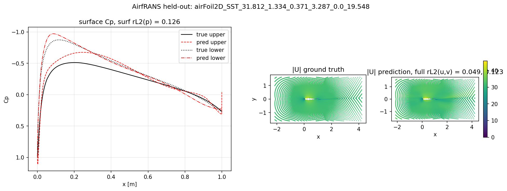
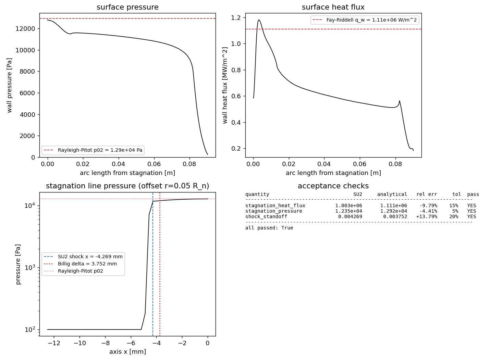

# transolver-hypersonic

A neural surrogate for the steady air flow field around axisymmetric sphere-cone
re-entry capsules in hypersonic flight. The architecture is built on top of
Transolver (Wu et al., ICML 2024,
[arXiv:2402.02366](https://arxiv.org/abs/2402.02366)). The ground truth is 753
SU2 solutions of the axisymmetric laminar Navier-Stokes equations, split into
training, validation and test sets as described under
[Test datasets](#test-datasets).

Work in progress. The final version should work as one pipeline of inference
and simulation: the model predicts what SU2 would have solved inside its
training range, and hands queries outside that range to a full SU2 solve. The
[dashboard](https://hypersonic-capsule-surrogate.streamlit.app) shows what
this looks like in an engineering workflow. The hand-off to SU2, and the
retraining that its solutions would feed, are not built yet.



The figure above shows a comparison between the SU2 ground truth (upper half) and the 
model prediction (lower half) using the temperature and density fields around a representative 
design of a capsule that was held out from the training set. This design was chosen such that 
about half/half of the remaining cases have a higher/lower relative L2 error. This particular 
one has nose radius 15 mm, cone half-angle 67 degrees, and Mach 17.8 at 51 km. The error concentrates 
in a thin band at the shock, where a small offset in shock position is a large local error.

## Current state

When you design a model architecture, or build on an existing one, you should
first validate it against a common benchmark. So the first task was to train
this model on the AirfRANS dataset ([Validation on AirfRANS](#validation-on-airfrans)).
Second, the SU2 simulation pipeline had to match known results within
acceptable bounds. I used three analytical results to measure quality and
convergence. Each is implemented in `src/analytical.py`.

1. Fay-Riddell equation (heat flux at the stagnation point):

   ```math
   \begin{gathered}
   q_w = 0.763\,\mathrm{Pr}^{-0.6}\,(\rho_w \mu_w)^{0.1}\,(\rho_e \mu_e)^{0.4}\,\sqrt{\left(\frac{du_e}{dx}\right)_s}\,(h_{0} - h_w) \\
   \left(\frac{du_e}{dx}\right)_s = \frac{1}{R_n}\sqrt{\frac{2\,(p_{02} - p_\infty)}{\rho_e}}
   \end{gathered}
   ```

   where Pr is the Prandtl number, rho and mu are density and viscosity at the
   wall (w) and at the edge (e) of the boundary layer on the stagnation streamline, 
   h_0 and h_w are the total enthalpy and the wall enthalpy, R_n is the
   nose radius and p_02 is the stagnation pressure behind the shock. The
   original equation covers dissociated air in thermal and chemical
   equilibrium around a blunt body. Here the Lewis number is set to one, which
   drops the dissociation term, because the solver models air as a calorically
   perfect ideal gas.

2. Rayleigh-Pitot equation (stagnation pressure behind a normal shock):

   ```math
   \frac{p_{02}}{p_\infty} = \left[\frac{(\gamma+1)^2 M_\infty^2}{4\gamma M_\infty^2 - 2(\gamma-1)}\right]^{\gamma/(\gamma-1)} \frac{1 - \gamma + 2\gamma M_\infty^2}{\gamma+1}
   ```

   where gamma is the ratio of specific heats and M_inf and p_inf are the
   freestream Mach number and static pressure. It gives the ratio between the
   total pressure behind the normal shock and the static pressure upstream of
   it, assuming calorically perfect air.

3. Billig correlation (standoff distance of the bow shock):

   ```math
   \frac{\Delta}{R_n} = 0.143\,\exp\!\left(\frac{3.24}{M_\infty^2}\right)
   ```

   where Delta is the distance from the nose to the shock along the axis. It is
   an empirical fit for the shock ahead of a spherical nose in supersonic and
   hypersonic flow.

With the pipeline validated ([Validation of the simulation pipeline](#validation-of-the-simulation-pipeline)),
I launched a sweep over the design space, which produced 727 converged cases
across 140 distinct geometries: a core box of 667 cases, plus four thin slabs
that sit outside it at large nose radius, small nose radius, high cone angle
and Mach number above 25. One experimental round of active learning then added
26 cases where the five members of the ensemble disagreed most, which brings
the dataset to 753.

## Evaluation questions

1. **Slice-count ablation.** The Physics-Attention block of Transolver assigns
   each mesh point to one of M learned slices and attends across the slice
   tokens, which costs O(M^2) instead of O(N^2) for N mesh points. How does M
   trade against accuracy in shock-dominated flow, and does the best M change
   between evaluation inside the training box and outside it?
2. **Geometric extrapolation.** Train on a narrow box in parameter space and evaluate on
   extreme nose radii, extreme cone half-angles, and Mach numbers above the
   training range. Where does the surrogate degrade, and can that boundary be
   predicted from the inputs alone?

## Test datasets

The training box spans Mach 8 to 25, altitude 45 to 60 km, nose radius 10 to
50 mm and cone half-angle 35 to 70 degrees. Every model is evaluated on the
same family of test tiers, in order of expected difficulty:

| tier | what it holds | slice ablation | ensemble and priors |
|---|---|---|---|
| interpolation | capsule shapes seen in training, new flight conditions | 43 | 54 |
| family holdout | whole capsule shapes absent from training, inside the box | 45 | 65 |
| high cone angle | cone half-angle 70 to 82 degrees | 14 | 14 |
| high Mach | Mach 25 to 30 | 18 | 18 |
| large nose | nose radius 50 to 100 mm | 20 | 20 |
| small nose | nose radius 4 to 10 mm | 8 | 8 |
| pooled extrapolation | the four slabs above together | 60 | 60 |



The dashed rectangle is the training box. Each slab leaves it along one axis
only, so the error on a slab can be traced to one parameter.

The slice-count runs use a pinned split that holds 680 of the sweep cases:
481 for training and 51 for validation. The ensemble and the priors split all
753: the ensemble trains on 507 cases (the 481 plus the 26 acquired) and
validates on 67. The acquired cases only ever go into training, never into a
test tier.

The error measure throughout is the relative L2 error per channel, computed in
physical units after the normalization is undone, then averaged over density,
both velocity components and temperature.

## Results

### Slice-count ablation

Four models that differ only in slice count M were trained on the same 481
sweep cases. The table gives the mean relative L2 error per tier, with the best
value in each column in bold. The per-run records are in
`results/slice_ablation/`.

| M  | interpolation | family holdout | high cone angle | high Mach | large nose | small nose | pooled extrapolation |
|----|------|------|------|------|------|------|------|
| 8  | 0.121 | 0.129 | 0.428 | 0.215 | 0.344 | **0.257** | 0.313 |
| 16 | 0.105 | 0.117 | 0.343 | 0.194 | 0.300 | 0.295 | 0.278 |
| 32 | **0.100** | **0.104** | 0.337 | **0.189** | 0.292 | 0.277 | 0.270 |
| 64 | 0.108 | 0.111 | **0.307** | 0.202 | **0.269** | 0.286 | **0.260** |

- Eight slices are too few. M = 8 is the worst inside the box and on the pooled
  extrapolation tier.
- From 16 to 64 slices, the error inside the box moves by less than 0.01.
  Each cell is a single training run, so a difference that small cannot be
  told apart from the noise of a different random seed. The published model
  uses M = 32.
- Outside the box the pooled error falls at every step, from 0.313 to 0.260,
  so more slices may still help extrapolation past M = 64. Confirming it
  needs repeated seeds per cell and larger M. Future work.

Inside the box, generalizing to a new capsule shape costs almost nothing: at
M = 32 the family holdout scores 0.104 against 0.100 on known shapes. The error
roughly triples where the flow leaves the box, which the next figure illustrates:



Each point is one test case at M = 32. Horizontal axis: how far the inputs
lie outside the range the training cases span, computed as the largest excess
of any input over that range, divided by the width of the range. A case
inside the range lies at zero. The plot shows the two kinds of failure the final system
must handle. First, a query can fall outside the training box, and each
direction of parameter space responds differently to extrapolation, so the
rule that refuses a query should depend on the direction. Second, a query can
sit inside the box in a regime the model finds hard, which needs a remedy of
its own. Both are future work.

### Uncertainty quantification

Five Transolvers at M = 32 differ only in their starting weights and data
order. This makes them a deep ensemble: the mean over members is the
prediction, and the spread across members measures uncertainty. This is the
model the dashboard serves. The mean beats the best single member on every
tier:

| tier | ensemble | best single member | mean spread |
|------|------|------|------|
| interpolation             | 0.084 | 0.092 | 0.064 |
| family holdout            | 0.083 | 0.094 | 0.069 |
| high cone angle           | 0.220 | 0.250 | 0.160 |
| high Mach                 | 0.162 | 0.170 | 0.103 |
| large nose                | 0.276 | 0.277 | 0.153 |
| small nose                | 0.208 | 0.223 | 0.128 |

The margin over the best member grows where the flow leaves the training box.
The one exception is the large nose, where the two are indistinguishable.



Outside the box the spread tracks the actual error: the rank correlation
between a case's spread and its error is 0.74 to 0.86 on the four slabs.
Inside the box it is weak (0.55 on interpolation, 0.05 on the family holdout),
because those errors pack into a narrow range. So the spread detects
extrapolation, but it does not rank cases the model already handles well. It
also cannot see an error all five members share: the interpolation case at the
top left of the figure sits at 0.42 error with a low spread.

That gives an operational rule for whether to trust a prediction. Refuse when
the input falls outside the training envelope, either by an envelope distance
above 0.07 or by a Knudsen number past the continuum limit of 0.01, and also
when the spread exceeds 0.308. Warn at a spread above 0.077. Trust otherwise.
Over the 179 evaluation cases:

| decision | cases | median error | 90th-percentile error |
|------|------|------|------|
| trust  | 93 | 0.078 | 0.114 |
| warn   | 18 | 0.120 | 0.187 |
| refuse | 68 | 0.159 | 0.362 |



Every refusal comes from the inputs, the envelope distance or the Knudsen
number. No case reaches the refuse threshold on spread. Sixteen refused cases
come from inside the box: ten family-holdout shapes lie just past the range
the training shapes span, and six cases pass the Knudsen limit. Their median
error is 0.084 against 0.078 for trusted cases, so the rule is cautious there,
not wrong.

### Physics priors in the low-data regime

Three physics priors are built into the surrogate. Pressure is reconstructed
from the equation of state instead of predicted, and density and temperature
are standardized in log10 space. Wall heat flux is available either as a
direct prediction or as a residual against the Fay-Riddell correlation. Each
prior was switched off in turn and compared against a baseline that carries all
three.



The figure shows why the log prior exists. Each field spans orders of
magnitude: most nodes sit in the cold, thin freestream, and a few in the shock
layer. Plain standardization (top row) keeps that shape, and density reaches 25
standard deviations above its mean. After a log transform (bottom row) every
field stays within four.

Priors of this kind earn their place when data is scarce. For this reason the
ablation trains on 100 cases drawn from the core box, stratified by geometry. 
The test tiers keep their full size (the right-hand column under
[Test datasets](#test-datasets)). Three seeds ran per cell, at 500 epochs with
cosine decay. That schedule differs from the 350-epoch recipe of the ensemble,
so these rows compare with each other and not with the tables above. The table
below shows the mean and standard deviation over the seeds. The error columns 
average the relative L2 error over density, both velocity components and temperature. 
There are two additional columns for direct physics checks:

- equation-of-state violation: the median of |p - rho R T| / p over test
  nodes. It is zero whenever pressure is computed rather than predicted.
- nonphysical: the largest fraction of nodes predicted with zero or negative
  density, temperature or pressure.

| prior cell | interpolation | family holdout | pooled extrapolation | q_w error | equation-of-state violation | nonphysical |
|---|---|---|---|---|---|---|
| baseline (computed p, log rho and T) | 0.118 +/- 0.008 | 0.138 +/- 0.012 | 0.313 +/- 0.014 | -- | 0 | 0 |
| p as a free output | 0.123 +/- 0.001 | 0.145 +/- 0.006 | 0.356 +/- 0.018 | -- | 0.0032 | 0 |
| plain standardization | 0.095 +/- 0.004 | 0.106 +/- 0.005 | 0.286 +/- 0.017 | -- | 0 | 0.023 |
| q_w head, direct | 0.128 +/- 0.003 | 0.153 +/- 0.004 | 0.327 +/- 0.018 | 0.075 +/- 0.004 | 0 | 0 |
| q_w head, Fay-Riddell residual | 0.151 +/- 0.002 | 0.171 +/- 0.007 | 0.331 +/- 0.005 | 0.061 +/- 0.006 | 0 | 0 |

Computed pressure:

- Predicting p as a free output does not help any error column, and it is
  worse on extrapolation, 0.356 against 0.313.
- It also breaks the equation of state by a median 0.3% at every node.
- Computing p costs nothing and guarantees consistency. Keep.

Log standardization:

- Plain standardization scores lower error on every tier: 0.095 against 0.118
  inside the box and 0.286 against 0.313 outside it.
- It does so while predicting zero or negative density, temperature or
  pressure on 2.3% of nodes. Those sit mostly in the freestream, where
  magnitudes are small, so the relative L2 barely registers them.
- A negative temperature is not a small error; it is an invalid flow state.
  The log prior trades a few percent of L2 for a field that is always
  physical. Keep.

Heat-flux head:

- Adding either head makes the four flow fields worse, by 0.01 to 0.03 inside
  the box. The model spends capacity on one extra output.
- The Fay-Riddell residual beats the direct head on heat flux, 0.061 against
  0.075, but costs more on the flow fields.
- Both heat-flux errors are medians over all test cases, scored against the
  wall heat flux SU2 reported. Neither is reliable within about 0.3 nose radii
  of the axis, where the solver data itself is unreliable (see the heat-flux
  panel under [Validation of the simulation pipeline](#validation-of-the-simulation-pipeline)).

## Validation on AirfRANS

A Transolver of 0.52M parameters, with 4 blocks, 32 slices, 8 heads and 128
hidden channels, trained on the [AirfRANS](https://github.com/Extrality/AirfRANS)
`scarce` task, 200 cases for training and 200 for test, over 200 epochs. It took
64 minutes on one Kaggle T4. Relative L2 per channel on the test split:

| channel       | relative L2 |
|---------------|--------|
| u             | 0.053  |
| v             | 0.124  |
| p / rho       | 0.094  |
| nu_t          | 0.102  |
| p on surface  | 0.072  |



The figure shows one held-out airfoil: the pressure coefficient along the
upper and lower surfaces (left), and the velocity magnitude from the solver
and from the model (right). The aim was never to compete with the published
AirfRANS Transolver; rather to confirm that the vendored Physics-Attention,
the training loop and the evaluation path all function end to end on a
free-tier accelerator, before they were pointed at the SU2 data.

To reproduce it, open `notebooks/01_validate_stack.ipynb` on Kaggle, attach
`zeteixeira/airfrans-dataset` as input, set the accelerator to T4, turn the
internet on, and run every cell.

## Validation of the simulation pipeline

One canonical 60-degree capsule with a 1-inch nose, a body radius of
0.0762 m, and a shoulder radius of 0.00762 m, at Mach 10, T_inf = 220 K,
p_inf = 100 Pa, and an isothermal cold wall at T_w = 300 K. SU2 version 8.5
solved it as axisymmetric laminar Navier-Stokes, with an ideal gas and
Sutherland viscosity. The solve has two passes: a first-order start, then a
restart at second order with the Roe scheme and the Venkatakrishnan limiter. The
mesh carried 66611 nodes and both passes together took 61 minutes.

| quantity              | SU2          | analytical                | relative error | limit |
|-----------------------|--------------|---------------------------|---------|-----|
| stagnation heat flux  | 1.003 MW/m^2 | 1.111 MW/m^2 (Fay-Riddell) | -9.79%  | 15% |
| stagnation pressure   | 12.35 kPa    | 12.92 kPa (Rayleigh-Pitot) | -4.41%  |  5% |
| shock standoff        | 4.27 mm      | 3.75 mm (Billig)           | +13.79% | 20% |



All three clear their stated limits. The wall pressure (top left) starts at
the Rayleigh-Pitot value on the axis and falls along the cone. The wall heat
flux (top right) peaks just off the axis and dips to about half its peak at
the axis itself. That dip is a known solver weakness: within about 0.3 nose 
radii of the axis its heat flux keeps moving even after the residuals have 
converged. The pressure along the stagnation line (bottom left) jumps at the 
shock, 4.27 mm ahead of the nose against Billig's 3.75 mm. One full converged 
tensor of `x, r, rho, u, v, T` per mesh node is at `data/samples/canonical_case.npz`.

To reproduce it on Linux or the Windows Subsystem for Linux, with SU2 version
8.5 on the executable search path and `pyvista`, `gmsh`, `matplotlib` and
`numpy` available:

```bash
python scripts/validate_cfd.py --iter-pass1 2500 --iter-pass2 8000
```

The driver writes the mesh, the two-stage configuration, the SU2 logs, the
volume and surface files, a comparison figure, a summary in JSON, and the
training tensor, all into `data/raw/cfd_validation/`.

## Dataset generation

The dataset was generated on a single machine CPU (if you felt sorry reading that,
DM me for donations) using `scripts/generate_dataset.py`. It builds a Latin hypercube 
over the geometry parameters (R_n, theta_c, R_b, R_s) and the freestream conditions
(Mach, T_inf and p_inf through altitude) around a core box, and four dedicated
slabs past the box edges for extrapolation. Each case runs the two-pass
algorithm above, with the geometric multigrid that the sharper cones and the higher
Mach numbers need to converge.

Every case is compared with the three analytical correlations, and the
comparison is logged, but it does not decide acceptance. Away from the
canonical case the sweep sits a median 8 to 37% below Fay-Riddell, and above a
cone half-angle of about 60 degrees the shock stands farther off than Billig.
Those misses are not yet explained.

The model predicts four primitives (rho, u, v, T) at every mesh node.
Pressure is reconstructed as `p = rho * R_specific * T` at output time, so the
equation of state holds exactly and the network has no degree of freedom with
which to break it. The normalization statistics are computed per field on the
training split alone and are saved beside each checkpoint.

The converged cases, as `case_*.npz` tensors with the ledger, are published as
the Kaggle dataset `zeteixeira/su2-hypersonic-sphere-cone`, which the training
notebook reads.

## Scope

The surrogate predicts steady laminar flow over axisymmetric sphere-cone
capsules at zero angle of attack. Training covers Mach 8 to 25, and evaluation
reaches Mach 30 outside that range. The gas is ideal and calorically perfect
air, the viscosity follows Sutherland, and the wall is isothermal at 300 K.
There is no turbulence model, no real-gas thermochemistry, no radiation and no
ablation. The value of the surrogate is speed at acceptable accuracy, and not
accuracy above SU2.

## Repository layout

```
src/
  analytical.py            # Fay-Riddell, Rayleigh-Pitot, Billig, Sutherland
  geometry/sphere_cone.py  # parametric sphere-cone and gmsh meshing
  cfd/runner.py            # SU2 configuration rendering and solver driver
  cfd/postprocess.py       # surface and axis-line readers, shock standoff
  cfd/ledger.py            # SQLite case ledger for the resumable sweep
  eval/sanity.py           # comparison against the analytical correlations
  eval/metrics.py          # relative L2 and the names of the evaluation tiers
  eval/uncertainty.py      # deep ensemble, spread and the trust/warn/refuse rule
  eval/plots.py            # field plots on the capsule mesh, AirfRANS figure
  data/airfrans.py         # AirfRANS dataset, normalization, loading
  data/sampler.py          # design-box sampling for the sweep
  data/su2.py              # SU2 case dataset, splits, normalization
  training/loop.py         # training and evaluation loop, for SU2 and AirfRANS
  models/transolver.py     # vendored Transolver (MIT, thuml/Transolver)
configs/
  sphere_cone_template.cfg # SU2 axisymmetric laminar Navier-Stokes template
  prior_splits_100.json    # pinned low-data split for the prior ablation
scripts/
  validate_cfd.py          # single-case SU2 validation driver
  generate_dataset.py      # resumable dataset sweep runner
  train.py                 # training entry point, slice sweep, ensembles
  slice_ablation.py        # ablation tables and the guard threshold
  ensemble_uq.py           # deep-ensemble uncertainty and the decision rule
  prior_ablation.py        # physics-prior split builder and results table
  run_cases.py             # resumable SU2 job runner with a first-order start and settle rounds
  figures.py               # draws every figure in data/samples from the records
app/
  app.py                   # Streamlit dashboard: sliders, verdict, solve time, fields, learned slices
  inference.py             # meshing, ensemble prediction, the decision and the slice map for one query
  su2_wall_time.csv        # SU2 wall time of every solved sweep case, for the solve-time comparison
notebooks/
  01_validate_stack.ipynb  # AirfRANS validation, Kaggle orchestrator
  02_train_su2.ipynb       # SU2 training runs, Kaggle orchestrator
data/samples/              # committed example outputs: figures and one case
results/                   # per-run evaluation records behind every results table
tests/                     # tests of src, and a check that every results table here reproduces
```

## License

Code in `src/models/transolver.py` is adapted from
[thuml/Transolver](https://github.com/thuml/Transolver), MIT licensed,
copyright 2024 THUML at Tsinghua University, with the differences noted in the
header of that file.
